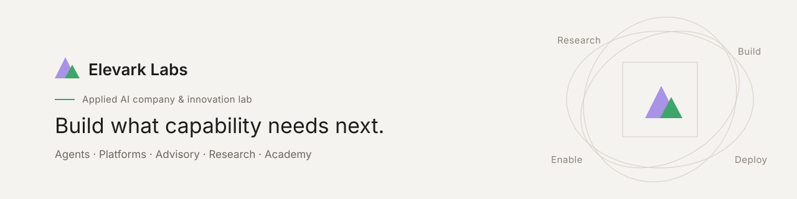

  

  
  

## Elevark Labs

**An applied AI company and innovation lab.** We research emerging capability, test it, build with it, deploy it, operate what we create — and help other people and organizations do the same.

Access to a powerful model isn't the same as knowing what to build, how to deploy it, or how to make it useful. We work across that whole gap. For us a lab isn't a place where ideas stay experimental; it's an operating model. A prototype that works is a starting point. Real use is where reliability, adoption, economics, and edge cases show up.

### What we build

| Division | Focus |
| --- | --- |
| **Agentic** | Systems that carry context, use tools, coordinate work, and extend human capability, with accountability kept intact. |
| **Platforms** | Applications, workflows, and products that turn AI capability into durable, useful software. |
| **Advisory** | Strategy tied to prioritization, implementation, adoption, and measurement. |
| **Research** | Practical, evidence-based work that separates capability from marketing. |
| **Insights** | Clear reads on launches, claims, and research, so the signal stands out from the noise. |
| **Academy** | Learning, coaching, and responsible-use practice for directing AI well. |

### How we work

1. **Understand the work.** Find where a real capability gap exists before reaching for a model.
2. **Build for use.** Turn a promising idea into something people can test, adopt, and improve.
3. **Deploy and observe.** Learn from live systems what a prototype can't show.
4. **Enable the people.** Make the result understandable, directed, and durable after launch.

### Products

- **[SparkRuck](https://sparkruck.com)**, a platform built and operated by Elevark Labs.

### Engineering principles

- **Capability over novelty.** Ship what creates new capability, not what looks futuristic.
- **Build to learn.** The fastest way to understand a technology is to build with it and watch where it breaks.
- **Humans set the purpose.** Agents execute; people decide what matters and what happens next.
- **Evidence over hype.** We're explicit about what works, what might, and what's still experimental.
- **Real-world proof.** A demo shows possibility. Reliable performance in production proves value.

### Stack we reach for

  
  
  
  
  
  

### From the journal

Read more at [elevarklabs.com](https://elevarklabs.com).

- **The Capability Unlock**: AI's biggest effect may be the capability it puts within reach.
- **Why the Next Great AI Products Will Be Purpose-Built**: focused workflows beat general-purpose demos.
- **Start With the Work, Not the AI**: strategy begins with bottlenecks, decisions, and handoffs.
- **The Shift From AI Tools to AI Agents**: assistants, automation, and agents are different things.

### Work with us

Building something that needs agents, a purpose-built platform, or a clear-eyed AI strategy? **[Get in touch →](https://elevarklabs.com/contact)**

Security issues: please see our <a href="https://github.com/elevarklabs/.github/blob/main/SECURITY.md">security policy</a> instead of opening a public issue.
